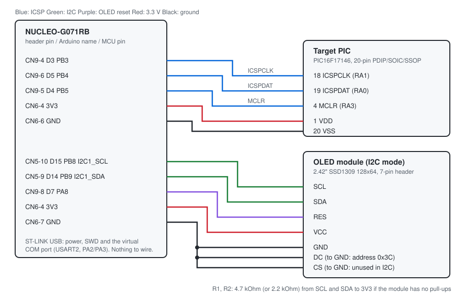

# Hookup guide

How to wire the NUCLEO-G071RB to a target PIC and to the optional OLED status display.
Every pin below is taken from a document; the source is given with each table.

## MCU pins in use

| MCU pin | Header | Arduino | Use | Source |
|---|---|---|---|---|
| PB3 | CN9-4 | D3 | ICSPCLK to the target (output) | UM2324 Table 12, `include/icsp.h` |
| PB4 | CN9-6 | D5 | ICSPDAT to the target (bidirectional, weak pull-down) | UM2324 Table 12, `include/icsp.h` |
| PB5 | CN9-5 | D4 | MCLR to the target (output) | UM2324 Table 12, `include/icsp.h` |
| PB8 | CN5-10 | D15 | I2C1_SCL to the OLED (open drain, AF6) | UM2324 Table 12, DS Table 14 |
| PB9 | CN5-9 | D14 | I2C1_SDA to the OLED (open drain, AF6) | UM2324 Table 12, DS Table 14 |
| PA8 | CN9-8 | D7 | OLED RES (output, pulsed low at boot) | UM2324 Table 12 |
| PA2 | - | - | USART2 TX to the ST-LINK virtual COM port | UM2324 6.9, Table 8 |
| PA3 | - | - | USART2 RX from the ST-LINK virtual COM port | UM2324 6.9, Table 8 |
| PA5 | - | D13 | On-board user LED LD4 | UM2324 6.10 |

Power and ground come from the CN6 power header: 3V3 on CN6-4, GND on CN6-6 and CN6-7, and
a further GND on CN5-7 (UM2324 Table 12).

PA2/PA3 reach the virtual COM port through solder bridges SB16/SB18, which are fitted by
default (UM2324 Table 8). There is nothing to wire for the serial link: the ST-LINK USB
cable carries power, SWD and the serial port.

Do not connect anything to CN8-5 or CN8-6 (A4/A5). UM2324 Table 12 lists I2C1 on those pins
too ("PB9 or PB11", "PB8 or PB12", depending on solder bridges), so they may be tied to the
I2C pins the OLED uses.

## Target PIC

The PIC is powered from the Nucleo's 3.3 V, within the 1.8 to 5.5 V programming range of
the PIC16F171XX programming specification. Only low-voltage programming is supported: the
part must have its LVP configuration bit set (the factory default), because the Nucleo
cannot supply the 7.9 to 9.0 V high-voltage MCLR level.

| Nucleo | Signal | PIC16F17124 14-pin SOIC/TSSOP/PDIP | PIC16F17124 16-pin QFN/VQFN | PIC16F17146 20-pin SSOP/SOIC/PDIP | PIC16F17146 20-pin QFN/VQFN-S |
|---|---|---|---|---|---|
| D3 (PB3) | ICSPCLK (RA1) | 12 | 11 | 18 | 15 |
| D5 (PB4) | ICSPDAT (RA0) | 13 | 12 | 19 | 16 |
| D4 (PB5) | MCLR (RA3) | 4 | 3 | 4 | 1 |
| 3V3 (CN6-4) | VDD | 1 | 16 | 1 | 18 |
| GND (CN6-6) | VSS | 14 | 13 | 20 | 17 |

Source: PIC16F171XX Family Programming Specification DS40002266B, Table 6-1. For other
parts in the device table, take the ICSPCLK, ICSPDAT, MCLR, VDD and VSS pins from that
part's own programming specification.

## OLED status display (optional)

For the 2.42" SSD1309 128 x 64 module with a 7-pin header (GND VCC SCL SDA RES DC CS). The
header order does not match the Nucleo's Arduino header (SCL and SDA are swapped relative
to D15/D14, and the STM32 cannot swap them: PB8 only offers SCL and PB9 only SDA), so use
jumper leads.

| Module | Nucleo | Notes |
|---|---|---|
| GND | GND (CN6-7) | |
| VCC | 3V3 (CN6-4) | Not CN5-8: that pin is AVDD/VREF+, the analog reference supply |
| SCL | D15 (PB8) | |
| SDA | D14 (PB9) | |
| RES | D7 (PA8) | Held low for 10 us at boot (SSD1309 minimum 3 us, datasheet Table 13-1) |
| DC | GND | Selects I2C address 0x3C (3V3 gives 0x3D; the firmware tries both) |
| CS | GND | Not used in I2C mode |

Prepare the module first (from seller listings and user reports, not a module datasheet;
check the silkscreen on your board):

1. **Switch it from SPI to I2C.** It ships set to SPI. On boards with R3/R4/R5 next to the
   header, remove R4 and bridge R3 and R5. Other revisions use R13/R15/R17 instead.
2. **Pull-ups.** The SSD1309 requires pull-ups on SDA and SCL (datasheet 8.1.5), and it is
   not confirmed that the module has them. If the display does not answer, fit 4.7 kOhm from
   each line to 3V3.

The SSD1309 also needs a 7 to 16 V panel supply besides its logic supply (datasheet 2, 8.8),
so the module must generate that from its VCC pin.

Without a display, leave these pins unconnected; the firmware finds no display and does
not use the bus.

## Parts list

Prices and stock from Mouser, looked up on 2026-10-16 (single-unit price).

| Qty | Part | Manufacturer part number | Mouser number | Unit price | Used for |
|---|---|---|---|---|---|
| 1 | STM32 Nucleo-64 board with STM32G071RB | NUCLEO-G071RB (STMicroelectronics) | 511-NUCLEO-G071RB | $19.72 | The programmer |
| 1 | PIC16F17146, 20-pin PDIP | PIC16F17146-I/P (Microchip) | 579-PIC16F17146-I/P | $2.43 | First target |
| 1 | PIC16F17124, 14-pin PDIP | PIC16F17124-I/P (Microchip) | 579-PIC16F17124-I/P | $2.08 | Second target |
| 2 | Resistor 4.7 kOhm 5 % 1/4 W, through hole | CFR-25JB-52-4K7 (YAGEO) | 603-CFR-25JB-52-4K7 | $0.10 | I2C pull-ups R1, R2 (default) |
| 2 | Resistor 2.2 kOhm 5 % 1/4 W, through hole | CFR-25JB-52-2K2 (YAGEO) | 603-CFR-25JB-52-2K2 | $0.11 | I2C pull-ups R1, R2 (long or heavily loaded bus) |
| 1 | Solderless breadboard, 830 tie points | PRT-12615 (SparkFun) | 474-PRT-12615 | $7.75 | Holds the target PIC and the pull-ups |
| 1 | Male/male jumper wires, 20 x 150 mm | 1957 (Adafruit) | 485-1957 | $1.95 | Nucleo header sockets to the breadboard |
| 1 | Female/male jumper wires, 10 x 300 mm | 5018 (Adafruit) | 485-5018 | $1.95 | OLED module header pins to the Nucleo |
| 1 | 2.42" SSD1309 128 x 64 OLED module, 7-pin, SPI/I2C | HiLetgo 2.42" SSD1309 (Amazon, not stocked by Mouser) | - | about $17 | Optional status display |

The OLED, its pull-ups and the female/male wires are only needed for the status display.

## Circuits

### ICSP link to the target (no extra parts)

Three direct wires plus power. PB3 (ICSPCLK) and PB5 (MCLR) are push-pull outputs. PB4
(ICSPDAT) is switched between output and input by the firmware; as an input it has the
STM32's weak pull-down enabled (25 to 55 kOhm, typical 40 kOhm, DS12232 Table 51) so that a
missing target reads as 0 instead of floating. All three use the low output speed setting,
which keeps edges slow on a cable; the ICSP clock runs at about 500 kHz. The target runs
from the Nucleo 3.3 V, inside the 1.8 to 5.5 V programming range.

### OLED reset (no extra parts)

PA8 (D7) is a push-pull output wired straight to the module's RES pin. It is held low for
10 us at boot (the SSD1309 needs at least 3 us, Table 13-1) and then high.

### I2C pull-ups R1, R2

One resistor from SCL to 3V3 and one from SDA to 3V3, needed if the module does not already
have pull-ups. The STM32 drives both lines open drain and also enables its internal
pull-ups, but those (25 to 55 kOhm) are far too weak on their own.

Simulated with ngspice (`docs/sim/i2c_pullup.cir`, swept by `tools/sim_i2c_pullup.py`):
the line is pulled low by the STM32 output (modelled from the weakest output in DS12232
Table 52, 0.4 V at 2 mA, so a worst case), then released. The fall time is measured
between the SSD1309's input levels, and the rise time between two pairs of thresholds: the SSD1309's own input levels (0.2 and 0.8 x VDD, Table 12-1) and the 30 to
70 % points I2C usually uses. The SSD1309 limits both rise and fall time to at most 300 ns
(Table 13-6); the datasheet does not say between which levels, so both are shown for the
rise. The internal
pull-up (typical 40 kOhm) is included in parallel in every case. The simulation assumes
the SSD1309 runs from 3.3 V; if the module regulates it lower, its thresholds scale down
with it.

| External pull-up | Effective | C bus | VOL | Rise 20-80 % | Rise 30-70 % | Fall 80-20 % | Within 300 ns |
|---|---|---|---|---|---|---|---|
| none (internal only) | 40.00 kOhm | 20 pF | 0.016 V | 1109 ns | 678 ns | 6 ns | no |
| none (internal only) | 40.00 kOhm | 50 pF | 0.016 V | 2773 ns | 1695 ns | 14 ns | no |
| none (internal only) | 40.00 kOhm | 100 pF | 0.016 V | 5546 ns | 3389 ns | 28 ns | no |
| none (internal only) | 40.00 kOhm | 200 pF | 0.016 V | 11091 ns | 6779 ns | 56 ns | no |
| 10 kOhm | 8.00 kOhm | 20 pF | 0.080 V | 222 ns | 136 ns | 6 ns | both |
| 10 kOhm | 8.00 kOhm | 50 pF | 0.080 V | 555 ns | 339 ns | 14 ns | no |
| 10 kOhm | 8.00 kOhm | 100 pF | 0.080 V | 1109 ns | 678 ns | 29 ns | no |
| 10 kOhm | 8.00 kOhm | 200 pF | 0.080 V | 2218 ns | 1356 ns | 58 ns | no |
| 4.7 kOhm | 4.21 kOhm | 20 pF | 0.150 V | 117 ns | 71 ns | 6 ns | both |
| 4.7 kOhm | 4.21 kOhm | 50 pF | 0.150 V | 292 ns | 178 ns | 15 ns | both |
| 4.7 kOhm | 4.21 kOhm | 100 pF | 0.150 V | 583 ns | 356 ns | 30 ns | no |
| 4.7 kOhm | 4.21 kOhm | 200 pF | 0.150 V | 1166 ns | 713 ns | 61 ns | no |
| 2.2 kOhm | 2.09 kOhm | 20 pF | 0.289 V | 58 ns | 35 ns | 7 ns | both |
| 2.2 kOhm | 2.09 kOhm | 50 pF | 0.289 V | 145 ns | 88 ns | 17 ns | both |
| 2.2 kOhm | 2.09 kOhm | 100 pF | 0.289 V | 289 ns | 177 ns | 34 ns | both |
| 2.2 kOhm | 2.09 kOhm | 200 pF | 0.289 V | 578 ns | 353 ns | 67 ns | no |

How to read it:

- **Falls are never the problem:** the STM32 pulls the line low actively, so even the
  worst case (200 pF) falls in 67 ns.
- **Internal pull-ups alone never work** at this bus speed, even with almost no wiring.
- **4.7 kOhm** meets the limit by both measures up to about 50 pF of bus capacitance:
  short jumper wires and one module.
- **2.2 kOhm** meets it up to about 100 pF, for longer wires. The low level stays at
  0.29 V, below the SSD1309's VIL of 0.66 V, and the STM32 sinks 1.6 mA, inside its 2 mA
  test condition.
- The bus capacitance of a given setup is not known in advance; it depends on the wires
  and the module. Start with 4.7 kOhm. Use 2.2 kOhm if a scope shows slow rising edges.
  Do not go lower without checking acknowledges: the SSD1309 warns that track resistance
  and the pull-up form a divider that can stop its acknowledge reaching a valid low
  (datasheet 8.1.5), and a stronger pull-up makes that worse.

Re-run with `tools/sim_i2c_pullup.py docs/sim/i2c_pullup_results.md` after changing the
netlist or the values swept.

## Before powering up

1. Unplug the ST-LINK USB cable while wiring.
2. Check VDD and VSS on the target against the table for its package.
3. Check that nothing else on the target board drives MCLR, ICSPCLK or ICSPDAT.
4. Plug in USB. LD4 toggles every second when the firmware is running.

## Checking the result

- Over SWD: `g_pic_status` is 0 when a part was recognised. A PIC16F17146 reads device ID
  `0x30E1`, a PIC16F17124 `0x30DC` (DS40002266B 2.6).
- Over the serial port (921600 baud, 8N1): send `PROBE`; the reply is
  `OK <name> <device id> <revision id>` or `ERR <code> <text>`.
- `ERR -5 no target answered`: the ID read back as 0. Check the wiring, target power, and
  that LVP is enabled on the part.
- No picture on the OLED: check the SPI-to-I2C change, the pull-ups and the RES wire. If
  the picture is upside down, rebuild with `-DOLED_FLIP=1`.
- Still no picture, with wiring and pull-ups correct: the module may never acknowledge.
  The SSD1309 only acknowledges through its SDAOUT pin, which a module may leave
  unconnected (datasheet 8.1.5), and the firmware then decides there is no display.
  Check for continuity between the module's SDA pin and the panel's SDAOUT, or rebuild
  with `cmake --preset Release -DI2C_IGNORE_ACK=ON`. That build drives SCL and SDA in
  software at about 250 kHz, ignores acknowledges and uses address 0x3C only (DC tied to
  GND; build with `OLED_I2C_ADDR=0x3D` otherwise). It can no longer tell whether a display
  is attached.
